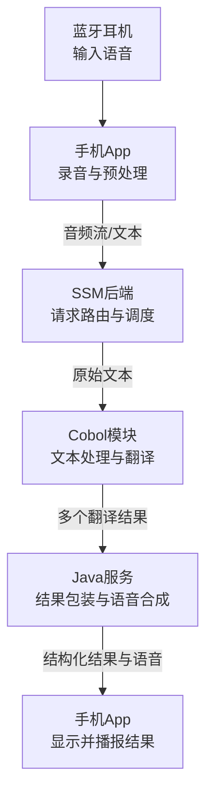

## Z026/11/27（五）

### Q：Uni-Voice 介绍，研发背景，现状，评价影响

### A：GPT

# **Uni-Voice：日本面向视障人士、老年人和外国人的无障碍信息技术**

[iOS・Androidアプリ「Uni-Voice」の使い方｜小林クリエイト](https://images.openai.com/static-rsc-4/ZI1aI-889nNciy-_gCdJ689midSbUeAkexV8fS9kpNnLswAI-aLzDPPTv67IwALqxxXgPy8rNoX7WbkRLYIXFCLPj-4AiuwtB60qBkSWREsfKoZx1lGNjw3EC37nuYtlBFnXnwclnj6mNW4IzdNSd669PLFgTBGGVcsgiLoibjA?purpose=inline)

**Uni-Voice（ユニボイス）**

日本开发的无障碍语音信息技术（音声コード）

已投入实际应用

核心理念：让纸面文字、公共信息和导航信息能够通过手机被听见。

首先要澄清：Uni-Voice 并不是普通的语音识别软件，也不是简单的文字转语音 App。

它的核心是一种特殊的二维编码技术：**把文字、多语言信息和位置导航数据编码到专用二维码中，再由手机读取、显示和朗读。**

它主要解决三个问题：

1. 视障人士无法直接阅读纸质通知、政府文件。
2. 老年人阅读小字体、复杂公共文件存在困难。
3. 外国人在日本难以理解日文公共信息和设施说明。

它的意义在于，将无障碍设计从单纯的点字、人工协助，扩展到了普通印刷品、智能手机和公共信息系统。

## **一、研发背景：为什么日本要开发 Uni-Voice？**

### **1. 最初要解决的问题**

Uni-Voice 的开发背景，与日本视障人士的信息获取问题密切相关。

传统的信息无障碍方式主要有：

- 点字（Braille）：需要专门学习点字，并非所有视障人士都会使用。
- 盲文出版物：制作成本较高，无法覆盖所有日常文件。
- 人工朗读：需要工作人员协助，效率和即时性有限。
- 普通二维码：虽然可以存储信息，但需要手机屏幕定位、操作和识别，对视障人士并不友好。

JAVIS（日本视覚障がい情報普及支援協会，日本视障信息普及支援协会）提出了一个思路：

**不改变普通人使用的纸质文件，而是在文件上增加一个可以被手机读取并朗读的特殊编码。**

JAVIS 官方介绍指出，项目希望解决约九成视障人士不熟悉点字、难以获得普通文字信息的问题。

[image](https://www.google.com/s2/favicons?domain=https://www.javis.jp\&sz=32)

Uni-Voice


### **2. 研发时间线**

1. **2009年（平成21年）**

   开发早期手机使用的 Uni-Voice 音声编码读取应用及辅助设备，实现将约800～1000个文字信息转换为二维编码，并通过手机朗读。
2. **2013年**

   Uni-Voice 事业企划株式会社成立，开始承担相关商业化和服务推广工作。
3. **2015年（平成27年）**

   推进智能手机适配和第三方 SDK 开发，使技术能够更容易地融入其他系统。
4. **2021年3月**

   Uni-Voice Blind 增加 NAVI、SPOT 导航编码读取功能，从文字信息辅助扩展到位置和路线引导。
5. **2021年以后**

   日本《障害者差別解消法》修订，合理配慮的法律要求进一步扩大到民间企业。无障碍信息技术的社会需求随之提升。
6. **2023～2025年**

   连续三年获得日本总务省「情報アクセシビリティ好事例」相关优秀案例认定。
7. **2026年**

   应用场景继续扩展到防灾、旅游、国立公园、公共网站和行政文件等领域。

早期研发时间和技术演进可以从日本厚生劳动省2015年公开的残障人士辅助设备开发资料中得到印证。

[image](https://www.google.com/s2/favicons?domain=https://www.mhlw.go.jp\&sz=32)

厚生労働省+1


### **3. 主要研发和产业化主体**

这里需要区分三个角色：

| 主体                     | 主要职责                 |
| ---------------------- | -------------------- |
| JAVIS                  | 原始技术开发、标准推广、编码制作软件   |
| Uni-Voice事业企划株式会社      | 商业化、应用开发、解决方案及多语言服务  |
| Grape System（グレープシステム） | 编码生成技术、SDK、批量打印和系统集成 |

这是一种由公益组织提出社会需求、技术企业进行产品化、产业伙伴参与系统集成的合作模式。

[image](https://www.google.com/s2/favicons?domain=https://www.uni-voice.co.jp\&sz=32)

Uni-Voice事業企画株式会社+2

## **二、技术原理：它究竟是怎么工作的？**

[iOS・Androidアプリ「Uni-Voice」の使い方｜小林クリエイト](https://images.openai.com/static-rsc-4/ZI1aI-889nNciy-_gCdJ689midSbUeAkexV8fS9kpNnLswAI-aLzDPPTv67IwALqxxXgPy8rNoX7WbkRLYIXFCLPj-4AiuwtB60qBkSWREsfKoZx1lGNjw3EC37nuYtlBFnXnwclnj6mNW4IzdNSd669PLFgTBGGVcsgiLoibjA?purpose=inline)

[JAVIS日本視覚障がい情報普及支援協会 | Uni-Voice](https://images.openai.com/static-rsc-4/6mhoK9aNBNEru8atRNVT7vrtRIURrIbSOyk_oT_jvN7S28_wDqhFTp0ipr5t_ltHygCCME_qdZB_z8-bIP0VSebtQrXvh-PoVaWQ3Nd-N2Hs4n5GcD3nOiDGooEx5aZvnyVY1872h44yl_vg6ZW5TpHkGq2ynG98WE55fHNvr6g?purpose=inline)

[耳で聴くハザードマップ - 神奈川県ホームページ](https://images.openai.com/static-rsc-4/t-1NyHowE_A-sfHSTOBPn9_10fK_TAdz8K8KcNrzWPt16wwVExRLAd_9UeAy4HAFP7i0AUr8CMDrA06PeSgHoYNiHqz8R14-YoGNoBqp-jwARQ9sAsCYfdI7vjA78Id7w6crT3yq5SuWTdtU5CzlRF61mcJYCN1HXLtSauGRk28?purpose=inline)

14

可以把它理解为：

**纸质文件 → 特殊二维编码 → 手机摄像头 → 数据解码 → 文字显示 → 语音合成。**

具体过程：

1. 政府或企业将文件文字转换为 Uni-Voice 编码。
2. 把编码印刷在通知书、宣传册、地图等纸质材料上。
3. 用户打开 Uni-Voice 或 Uni-Voice Blind。
4. 手机摄像头扫描编码。
5. App 读取里面的文字和相关信息。
6. 手机通过 TTS（Text to Speech，文本转语音）朗读内容。

### **Uni-Voice 与普通 QR Code 的区别**

| 比较项目   | 普通 QR Code | Uni-Voice          |
| ------ | ---------- | ------------------ |
| 主要用途   | 网站、支付、信息链接 | 无障碍文字信息及导航         |
| 内容     | URL、文字、数据等 | 约800字的文字信息         |
| 朗读功能   | 需要额外程序     | 专用 App 支持          |
| 视障人士操作 | 需要额外适配     | 专门支持屏幕阅读器          |
| 多语言    | 取决于链接或应用   | 提供预先翻译的多语言编码       |
| 导航     | 通常依赖外部地图   | 支持专门的 NAVI、SPOT 编码 |

需要注意，Uni-Voice 并不是普通二维码的一个简单皮肤，而是有独立编码规格、读取应用和配套制作工具的技术体系。

[image](https://www.google.com/s2/favicons?domain=https://www.javis.jp\&sz=32)

Uni-Voice+1


### **四种核心编码**

[iOS・Androidアプリ「Uni-Voice」の使い方｜小林クリエイト](https://images.openai.com/static-rsc-4/BKXkEBx4JHyow42_iiwQ8OS9wrOuReRua9o23-QzI_TNxGaziGmoPeuUaCChDIKuU-vZ2ckm4tlqBt3VJje-Ae6-eG416741VylH_W3ZEyNVTIR4pQpG_r3sMvBjMkd_DaYRTTu9Fmkm8Nen_5J_d7BJFOjtRi_LK4RxCy9g7oQ?purpose=inline)

**1. 文书编码（文書コード）**

将通知、政府文件、宣传册等转换成可朗读的信息。

[Uni-Voice多言語コード |観光・展示・サイン | Uni-Voice事業企画株式会社](https://images.openai.com/static-rsc-4/SyjVwY4R0HtgZM9pWVxH3_Z8E4dXyE6GYavINzH926uY4ucLhKzgtpiaB6TsWts8sItAGap6eh9xTn4ishDgw3xb6iskPaxYChjnyun65yzKwYRKmK2PCpxmO_E-xdgPpPzdRfc8lckGWJkbW6Y5oC7jxmpkLy5DNYXt5ONxu9E?purpose=inline)

**2. 多语言文书编码**

支持19种在线语言、16种离线语言，包括简体中文、繁体中文、英语、韩语、越南语等。

[Uni-Voice NAVIコード（地図誘導サービス）など資料を紹介します : ブログ : 大津市議会議員　佐藤弘](https://images.openai.com/static-rsc-4/SEDCe0gT-3x5W7-8MX0tJRwz0U96xgG_r4pbhVKcaGXctgBYgfh9l_aTNXaHNSXVmxmH2ZZiwL9lZ8UjLPtMxEzMOtYI2onZaWJFwne7p0b0E7FyXVeLx2SB6GTwfJEfGZCmspcJ2JzxtcR6cmS07qdJKG1ickbhyF2d4N4cPqs?purpose=inline)

**3. NAVI 编码**

储存目的地和路线信息，通过语音、声音提示和振动等方式辅助导航。

[Arakurayama Sengen Park | Tourist information with Uni-Voice](https://images.openai.com/static-rsc-4/wE5CjsmrujVfZBEFpHDy9Q5Cgh34fXCAZqYOo0pMzUjk8EtTuJTXmSMqiHwOoAHcbKbSd_ME-RfQe_u2XAldrIQZiP_OOX7btpTDaWke4DEQevbZofKKoq4H90hLhI0l9lE7_PFgtuTn-yHe19KlVGDnel7NfXzwLoO4njyAyo4?purpose=inline)

**4. SPOT 编码**

用于多个地点的设施、景点信息介绍和引导。

[image](https://www.google.com/s2/favicons?domain=https://www.uni-voice.co.jp\&sz=32)

Uni-Voice事業企画株式会社+1

## **三、目前的应用现状（截至2026年11月）**

Uni-Voice 已经从最初的视障辅助工具，逐渐发展为日本公共信息无障碍服务体系。

### **1. 主要应用领域**

[マイナンバーカードの受取について／綾瀬市](https://images.openai.com/static-rsc-4/wHGUODTUe8obbFUEUrIElEoccZ9ek_EAhE9MQSE1aA3yE8ivQkHX18VPrVOEXixKV-FaGsC_R8szjixOcIb7cfU5Tfv5EqJ1c2VmjNt-7s7bN_qiPYSv_JIYhSIeGmDJDT_xhwDgNdds-GYs4RsLf4PnlW5mpFEwgFLLhma69yk?purpose=inline)

**政府行政文件**

- My Number 通知
- 年金定期通知
- 纳税通知书
- 国民健康保险相关文件
- 水费、电费等公共事业通知

[耳で聴くハザードマップについて／綾瀬市](https://images.openai.com/static-rsc-4/pfpypdCrU3wjn3BfvNrXl09QvXvcyluiWkGGnBah5vkXeWeYqDv3bCEpLcd7dfAJCr2ipnXjcOZrUB4Sx7hMO9Dfk4bpBtubDaQj4I4dP8q6YNOUXcHj2FT5l6ncpsB_eQm4OiNvCtkQczmQZUv2HhTMhRtRF2Iv7mt7koRDD4k?purpose=inline)

**防灾与避难**

「耳で聴くハザードマップ」（用耳朵听的灾害风险地图）。

通过手机语音获取所在地灾害风险、避难场所和相关信息。

[フレペの滝　マップ・みどころ・時間・ルート・駐車場等≪観光ジャパン≫](https://images.openai.com/static-rsc-4/qgkYbCLbCfoSan95AsEVACzH6uvEBhJaFeOeLnvTGtFkIq1wKVY9kddX9-d6RqovLVgI0VuAWRFXfckCs-4aw_M0dUroV68G9oFhcSAnTRfEs53VZIiUd-WZ3jaxlkoOvjck-6EYa39MRfJXp_8-r4DYRkps9kC8P6SeltRINgo?purpose=inline)

**旅游和国立公园**

景点说明、设施介绍、路线引导和多语言导览。

[視覚や聴覚を補助するiPhone『アクセシビリティ』機能とは？読み上げや点字にも対応｜KDDI トビラ](https://images.openai.com/static-rsc-4/teL6N6wmr1jzCPyLBv_W_foOGjhg1SVt_4WD3ua99fGH2SepcvI8k36YY3vj2XN58YLly1Jfbipq-PgOzzeMQG1uMBsL_ghhbgMTerzmmQvPnumOAmiUVt8SiqgHzNdVXPsEVbUs6llyZdEHMapMycnpdrJtVBagzBHQxsd-mQU?purpose=inline)

**网站无障碍化**

「耳で聴くWebサイト」，让视障人士通过语音和点字显示获取网站内容。

[image](https://www.google.com/s2/favicons?domain=https://www.uni-voice.co.jp\&sz=32)

Uni-Voice |Uni-Voice事業企画株式会社+1

### **2. 2026年最新推广情况**

目前可以确认的几个进展：

| 时间          | 进展                        |
| ----------- | ------------------------- |
| 2025年12月    | 多语言 Uni-Voice 已在12个国立公园应用 |
| 2026年6月     | 山形县开始使用「耳で聴くハザードマップ」      |
| 2026年7月     | 横滨市开始使用多语言版灾害地图           |
| 2026年8月     | 在爱媛县综合防灾训练中展示             |
| 2026年10月21日 | 京都市正式开始使用灾害地图服务           |

国立公园方面，日本环境省的官方合作伙伴资料显示，视障人士对应的 Uni-Voice 已有47个都道府县的应用实绩。多语言版本则在继续扩大国立公园覆盖范围。

[image](https://www.google.com/s2/favicons?domain=https://www.env.go.jp\&sz=32)

環境省+1


### **3. App 目前的发展**

**Uni-Voice Blind**

[使ってみた！災害リスク情報を音声で聴ける「耳で聴くハザードマップ」操作方法解説と避難場所誘導利用レポート | Spotlite](https://images.openai.com/static-rsc-4/Am80812LVf4g3A_HjJ4BrgOOGuGcHosne-uIhtqQS7au_MiXlBPzRJr5xPjZcNmYY7-lhMFYkWOaMGfEllwjJ4rHk-PAtE-C5AAghKwYdjTSMb_vUsSPSSSGX-oUqGG5XlhJUlLygdeQiNdTSsiy9wrHo0wiX8W4s8tpUmD-7-g?purpose=inline)

视障人士专用

- VoiceOver
- TalkBack
- 语音读取
- 防灾信息

**Uni-Voice**

[みんなが読めるソリューション、音声コード「Uni-Voice」｜小林クリエイト](https://images.openai.com/static-rsc-4/D74LR_pv_HblJz7dIibTpdlh5WvDOUuJ5_6n_cSOn9c9qxqn5LQepaRnoTiuP1h8R646j5nQlN7ZyoUU_mj2dtprSwQFwKyZlsHujj7KsYfgfLI_KuPhshKq1ZobGXRpuIelEqBja63jSdhdc9aUxF32wnYFnfY2ays-vmS0LRc?purpose=inline)

一般用户及外国人

- 多语言读取
- 文书扫描
- 景点导航
- 信息保存

两个 App 均免费提供 iOS、Android 版本。

Google Play 页面显示，Uni-Voice 的下载量已达到5万次以上，最近一次列出的更新日期为2026年9月3日。注意，这是下载量级别，不等于实际活跃用户数。

[image](https://www.google.com/s2/favicons?domain=https://play.google.com\&sz=32)

Google Play のアプリ+1


官方入口：

- [Uni-Voice 事业企划株式会社官网](https://www.uni-voice.co.jp/?utm_source=chatgpt.com)
- [JAVIS 日本视障信息普及支援协会](https://www.javis.jp/?utm_source=chatgpt.com)
- [Google Play：Uni-Voice](https://play.google.com/store/apps/details?id=jp.co.uv\&utm_source=chatgpt.com)

## **四、评价：这项技术的真正价值是什么？**

我认为 Uni-Voice 最值得关注的不是二维码技术本身，而是它背后的社会设计理念。

### **1. 社会价值：从特殊照顾转向信息平等**

传统模式是：

普通人阅读文件，视障人士需要另外申请点字文件或者找人朗读。

Uni-Voice 模式是：

普通人使用原有文件，视障人士使用手机读取同一份文件。

这实际上改变了信息服务的设计方式。

它不再要求残障人士适应一套独立的信息系统，而是尽可能让所有人共享同一份信息。

### **2. 技术价值：把无障碍能力嵌入基础设施**

这项技术的优势有几个：

- 不必为每种纸质文件开发独立 App。
- 不依赖持续联网即可读取已编码的文字。
- 可以通过 SDK 集成到政府和企业的信息系统。
- 支持批量生成个人化通知书。
- 可以扩展到多语言、导航和防灾领域。

尤其是年金通知、My Number 通知等个性化文件，具有较强的系统集成价值。

### **3. 商业价值：政府、企业和普通用户形成生态**

它的商业模式不是单纯依靠 App 收费。

**Uni-Voice 的产业生态**

**政府、自治体、企业**

文件、公共信息、旅游和防灾数据

**Uni-Voice 技术平台**

编码生成、SDK、批量打印、多语言服务

**免费读取 App**

视障人士、老年人、外国人、普通用户

政府和企业购买解决方案，普通用户免费使用读取工具。这种模式使社会公益和商业服务有机会结合。

### **4. 存在的问题与局限**

也不能过度评价它。

| 问题       | 具体表现                          |
| -------- | ----------------------------- |
| 需要普及     | 纸质文件必须事先印上编码                  |
| 需要安装 App | 用户必须知道如何使用专用应用                |
| 扫描条件     | 印刷质量、尺寸、光线会影响识别               |
| 多语言限制    | 主要依赖预先准备的翻译内容，并非实时翻译          |
| 导航局限     | NAVI、SPOT 依赖事先制作的地点及路线数据      |
| 防灾可靠性    | 必须保证灾害数据及时更新，并考虑断网、断电及定位失败等情况 |

特别是防灾场景，不能因为能够语音播报就认为已经解决了视障人士的全部避难问题。实际避难还需要考虑道路障碍、人员协助和实时灾情。

## **五、未来发展：值得关注的几个方向**

我认为 Uni-Voice 未来可能有五个重要发展方向。

1. **AI与语音技术结合**：不仅朗读文件，还可以用 AI 将复杂的行政文件解释成普通人容易理解的语言。
2. **多语言智能服务**：进一步降低外国人在日本生活、就医、办事的语言障碍。
3. **防灾系统集成**：与自治体的实时灾害数据、避难场所和应急通知系统结合。
4. **智慧城市**：在车站、医院、政府机关、博物馆和公共交通中普及。
5. **数字身份和电子文件**：将音声编码能力融入电子通知、电子账单和公共服务平台。

这里尤其值得关注 AI：Uni-Voice 负责可靠地获取原始信息，AI 可以进一步负责解释、归纳和个性化辅助。两者是互补关系，而不是简单替代。

## **六、对日本IT产业的启示**

从软件工程和系统开发角度看，这个项目很有研究价值。

它涉及的技术领域包括：

| 技术领域      | 对应开发内容         |
| --------- | -------------- |
| Java / 后端 | 行政文件生成、数据处理    |
| 二维码编码     | 数据编码与解码        |
| SDK       | 第三方系统集成        |
| 数据库       | 用户、地点、路线、公共信息  |
| 移动开发      | iOS、Android    |
| TTS       | 文本语音合成         |
| 多语言       | 翻译和本地化         |
| RPA       | 行政文件生成、批量处理自动化 |
| Web API   | 政府和企业系统的数据对接   |

尤其是日本政府、自治体、保险、年金、水道等系统，具有长期维护、批量数据处理、无障碍标准和系统集成需求。

对日软件工程师而言，这类项目不仅是一般的业务系统开发，还涉及社会基础设施和公共服务数字化。

## **七、综合评价**

## **Uni-Voice 的历史定位**

# **有实际社会价值的无障碍信息基础设施**

它不是颠覆性的人工智能技术，也不是技术门槛极高的算法创新，但它成功地将一个具体社会需求转化为可推广、可集成、可商业化的产品体系。

**三个值得肯定的方面**

1. 从真实的残障人士需求出发，而不是先有技术再寻找应用。
2. 从单一文字朗读扩展到多语言、防灾、导航和行政系统。
3. 形成公益组织、技术企业、政府和公共机构共同参与的生态。\
   **三个需要继续观察的方面**
4. 实际活跃用户和使用频率，而非单纯下载量。
5. 全国各地公共信息覆盖率和数据更新质量。
6. 能否与新一代 AI、智能手机和数字政府平台深度融合。

**一句话概括：**

Uni-Voice 是日本从2009年前后开始发展的无障碍信息技术，通过专用二维编码让视障人士、老年人和外国人能够听懂原本只能用眼睛阅读的纸质及公共信息；到2026年，已经从辅助阅读工具发展为涵盖行政通知、防灾、旅游和多语言导航的社会信息服务体系。

我认为，它最有启发性的地方是：**真正有价值的技术，不一定是让机器变得更聪明，也可以是让原本无法获得信息的人，重新获得平等获取信息的能力。**


## Z025/12/04（四）

Q：用ssm和开源的cobol框架,构建实时翻译系统, cobol处理文本,Java提取和表现语音信息,通过 app,将蓝牙耳机听到的语音实时翻译,提供3-4个方案选择

### A：GPT

太好了—这是一个有趣又实用的系统设计问题。我给你 **3 套 + 1 套POC备选方案（共4个）**，每个方案都包含：架构图概念（文字版）、关键组件（具体开源工具/库）、数据流 & 协议、COBOL 与 Java 的集成方式、优缺点、预计延迟区间、部署与运维要点，以及适合的使用场景／推荐理由。最后我给出**推荐方案与落地步骤（优先级）**，便于你马上开始实现 POC 并逐步生产化。

---

# 先说明需求核心（我理解的要点）

你要的系统要能做到：

* 手机 App（或穿戴设备）通过 **蓝牙耳机** 捕获语音（麦克风来自蓝牙 HFP/HSP），并将语音**实时**送到后端进行翻译再回放（或显示字幕）；
* **COBOL** 负责处理文本（例如：术语库、规则替换、行业化文本处理、历史数据校验等）；
* Java（SSM）负责音频流、ASR/MT/TTS 的协调、表现层与向 App 的实时通信；
* 尽量用开源组件（GnuCOBOL 等），并提供多种可行实现方案（有低延迟、离线可用、企业级集成、简单POC）。

---

# 方案要点比较（先看结论）

* **方案 A（低延迟实时流/生产级）**：WebRTC 音频流 + Java（SSM）实时处理 + 本地/服务器 ASR（Whisper-Streaming/Vosk）+ Marian/MarianNMT + CoquiTTS；**COBOL** 通过 REST/gRPC（LegStar 或 adapter）提供术语/规则服务。**优点：实时性好（300–800ms）**，适合要求低延迟的场景。
* **方案 B（离线优先/混合）**：App 本地做 ASR（Vosk/Whisper-tiny）+本地轻量 MT（Argos Translate）做初译，联网时升级到服务端更高质量模型。**COBOL** 在服务器端批量/同步处理（GnuCOBOL），通过 MQ 同步术语。**优点：可脱网、隐私好**。
* **方案 C（企业级与 COBOL 深度整合）**：Kafka 流 + Java SSM 微服务集群 + 后端大型翻译集群（GPU + Whisper/Marian）+ COBOL（GnuCOBOL）运行于容器或通过 LegStar 提供业务规则与词典服务。适合与已有 COBOL 系统深度整合（高吞吐、审计、可靠性）。**优点：企业集成度高、可扩展性强**。
* **方案 D（简易 POC / 快速上线）**：App 录短片段（例如 2–5s） -> REST 上传 -> Java SSM 调用云端 ASR/MT/TTS（或开源在云中运行）-> 结果返回。COBOL 用批处理或API处理文本。**优点：最快验证业务可行性，开发周期短，延迟较大（1–3s）**。

下面逐项展开细节。

---

## 共同基础组件（所有方案都会用到的建议）

* **SSM（Java）层**：Spring (或 Spring MVC) + Spring MVC 控制层 + MyBatis（或 JPA）做持久化；若偏向现代可用 Spring Boot 替代传统 SSM 以提高开发效率。
* **COBOL 引擎（开源）**：GnuCOBOL（又名 OpenCOBOL）——用来编译/运行 COBOL 程序。若需更完善的 Java-COBOL 桥接，可用 **LegStar**（HP/IBM 的开源桥接工具，能把 COBOL 转为 web service），或自建 adapter。
* **消息队列**：Kafka（高吞吐/流处理）或 RabbitMQ（简单/可靠）。
* **实时音频流**：WebRTC（推荐）或 WebSocket (PCM 或 Opus over WebSocket)；WebRTC 更适合移动端低延迟音频双向流。
* **ASR**：Whisper（可做 streaming 模式）、Vosk（离线、低资源设备）
* **MT**：MarianNMT（高性能）、OpenNMT、Argos Translate（轻量）
* **TTS**：Coqui (TTS) 或 Mozilla TTS；也可使用本地系统 TTS（iOS/Android）做回放。
* **容器/部署**：Docker + Kubernetes，GPU 节点用于 ASR/MT 模型（尤其 Whisper/Marian）
* **安全**：TLS、OAuth2/JWT、音频加密（SRTP）用于WebRTC、审计日志（GDPR/隐私合规）

---

# 方案 A：**低延迟实时流（生产级）** —— 推荐用于语音实时对话翻译

### 架构概述（文字版）

```
Bluetooth Headset (HFP mic)  <--->  Mobile App (captures audio)  --WebRTC-->  Java SSM WebRTC Gateway (Spring) 
    -> ASR Service (Whisper-Streaming / Vosk GPU) -> MT Service (Marian) 
    -> Text PostProcessing Service (调用 COBOL 规则 API) -> TTS Service (Coqui) 
    -> WebRTC Gateway -> Mobile App -> Bluetooth Headset playback
同时 Java SSM 提供字幕/文本 via WebSocket/HTTP2 给 App 显示
```

### 关键组件（开源/推荐）

* **客户端音频传输**：WebRTC (Android/iOS WebRTC SDK)
* **WebRTC Gateway**：Spring Boot + Kurento / Jitsi / mediasoup（可选择）或直接用 Pion/webrtc (Java wrapper)
* **ASR**：Whisper-Streaming（在 GPU 节点，低延迟模式）或 Vosk（CPU/离线）
* **MT**：Marian NMT / OpenNMT（GPU）
* **TTS**：CoquiTTS（GPU 或 CPU）或 Android/iOS 本地TTS作回放
* **COBOL**：GnuCOBOL + LegStar（把 COBOL 功能封装为 REST/gRPC 微服务）
* **消息通道**：Kafka（低延迟流处理）或 Redis Streams（轻量）
* **容器**：Docker + Kubernetes（Deployment + HPA）
* **协议**：WebRTC (SRTP) for audio, gRPC/HTTP2 between microservices

### 数据流（更细）

1. App 捕获蓝牙麦音并使用 WebRTC 发送到后端。
2. Java WebRTC Gateway 转成 PCM 或 Opus 流，分段（例如 200–500ms 帧）送到 ASR 服务（gRPC stream）。
3. ASR 返回中间文本（partial）和最终文本。
4. 文本送到 MT 服务，或在同一流水线并行请求。
5. 翻译结果先流式返回给 Java 层，同时调用 COBOL 微服务（REST/gRPC）进行专用术语替换、合规检查、格式化等。
6. 生成的目标文本送到 TTS，合成短音频（或直接用客户端 TTS 读出），同时也把文本通过 WebSocket 推给 App 做字幕显示。
7. App 接收音频并回放到蓝牙耳机（或用本地 TTS 直接朗读）。

### 预计端到端延迟（理想/典型）

* 音频分片 + 网络：~50–150 ms
* ASR (streaming, GPU): 150–300 ms（或更低，视模型）
* MT (GPU): 50–150 ms
* COBOL postproc: 10–50 ms
* TTS 合成: 100–300 ms（若使用 streaming TTS 可减少）
  **合计典型**：**300–800 ms**（可达到接近实时对话体验）

### 优点

* 最低延迟，适合语音对话翻译（双向）。
* 可在服务端做高质量 ASR/MT/TTS（更好效果）。
* COBOL 能即时参与文本处理（术语、规则）。

### 缺点

* 实现复杂，需运维 GPU 集群与 WebRTC 网关。
* 对网络质量敏感（移动网络波动需做抖动缓冲/回退）。
* 蓝牙麦克风音质（HFP）较差，影响 ASR 精度。

---

# 方案 B：**离线优先 / 混合（边缘 + 云）** —— 推荐用于隐私与离线场景

### 架构概述

```
Mobile App (local ASR Whisper-tiny / Vosk) -> local MT (Argos Translate) -> local TTS (Android/iOS or Coqui mobile)
（在线时）偶尔将文本/音频上报 Java SSM -> Server ASR/MT -> COBOL（GnuCOBOL）同步术语库 -> Server 回写改进词典至 App
```

### 关键组件

* **本地 ASR**：Vosk-mobile、Whisper-Tiny（量化）
* **本地 MT**：Argos Translate（基于 Marian, 可离线）
* **本地 TTS**：Android / iOS TTS 或轻量 Coqui Mobile
* **COBOL**：GnuCOBOL 运行在服务器，提供术语表/API；通过 MQ/REST 将术语推送至 App 的本地字典文件（JSON）
* **同步机制**：后台定时拉取/推送词典 & 更新模型词汇（delta）

### 数据流

* App 捕获音频 -> 本地 ASR -> 本地 MT -> 本地炫示/播报。
* 若网络可用且用户授权，关键文本异步上传到服务器，服务器的 COBOL 校验/改写后下发词库更新至设备（提升本地翻译质量）。

### 延迟

* **端到端 ≈ 150–500 ms**（取决本地模型速度，离线设备大多较快）
* 离线即刻反应，无网络波动影响

### 优点

* 隐私好、响应快、可脱网工作。
* 成本低，不需要持续 GPU 云资源。
* 用户体验稳定（网络不佳时仍能用）。

### 缺点

* 本地模型精度通常低于大型云模型（但持续同步 COBOL 术语可显著提升领域表现）。
* 对设备性能有要求（需投入量化模型/NNAPI/Metal 加速）。
* COBOL 的强处理逻辑需以离线词典/规则形式下发，涉及同步复杂性。

---

# 方案 C：**企业级流批混合 · COBOL 深度整合（高可靠）**

### 架构概述（适合既有大量 COBOL 资产的金融/保险/政府机构）

```
App -> WebSocket/WebRTC -> Java SSM Gateway -> Kafka topics (audio, asr, mt, postproc)
ASR / MT services (microservices, autoscaled, GPU) -> produce translations -> COBOL processing layer (GnuCOBOL in containers OR LegStar wrapping) consumes from Kafka -> produce final results -> TTS -> App
```

### 关键组件

* Kafka（事件流）
* Java SSM 集群 + Spring Cloud（服务发现、配置）
* COBOL：GnuCOBOL 在容器中运行（或将 COBOL 包装成 web service via LegStar / z/OS connector），直接消费消息并输出结果
* ASR/MT/TTS：作为服务微服务化，使用 GPU 池
* IDAM / Audit / Compliance 模块

### 数据流亮点

* 音频流化并写入 Kafka，所有后端服务订阅同一流（实现“多路并行”：ASR、噪声抑制、情感分析等同时运行）。
* COBOL 可读取 ASR 的“原始文本”或 MT 的中间文本，并做复杂规则引擎处理（如合同用语替换、法律格式化、审计条目）。
* 所有数据保存在可查询的事件存储，便于回溯审计。

### 延迟

* 由于中间带 Kafka，延迟通常 **500ms–1.5s**（可优化到 < 500ms 通过紧路径处理）。
* 吞吐与可靠性极好，适合高并发企业场景。

### 优点

* 与已有 COBOL 在线/离线资产深度整合（业务规则、历史数据、合规逻辑全部可用）。
* 高可靠、高可观测、适合企业合规需求。

### 缺点

* 架构复杂，部署与维护成本高。
* 如果不过度优化，延迟可能较方案 A 大。

---

# 方案 D：**POC / 最快可上线版本（录短句，REST）**

### 架构概述（最简单）

```
App(record 2–5s) -> REST upload (HTTP) -> Java SSM endpoint -> calls cloud ASR (e.g., Whisper API or server-side open-source model) -> MT -> call COBOL batch API for replacement -> return text + audio TTS -> App download/play
```

### 关键组件

* Java SSM + REST endpoints
* 后端 ASR/MT（可用开源模型部署或付费 API）
* COBOL：用 GnuCOBOL 批处理或 REST adapter 处理文本
* TTS：云端或本地 SDK 回放

### 延迟

* **1–3 秒**（视 ASR/MT与网络）——对实时对话不够，但可快速验证端到端功能

### 优点

* 开发速度最快（可在数天到数周完成 POC）
* 实现简单，风险低，便于展示 demo 给业务方/客户
* 成本最低（可先使用云 API）

### 缺点

* 体验非实时（不适用于流式对话）
* 无法考验低延迟路径与并发处理

---

# COBOL 与 Java 的集成方式（四种选择，按复杂度/实时性排序）

1. **REST/gRPC Adapter（推荐）**

   * 使用 LegStar 或自写 wrapper，把 COBOL 程序包装为 REST/gRPC 微服务（容器化）。Java 通过 HTTP/2/gRPC 调用。
   * 优点：开发低成本、可横向扩展、符合微服务架构。

2. **消息队列（Kafka/RabbitMQ）**

   * Java 把文本写入 Kafka，COBOL 消费（或中间 adapter 消费并调用本地 COBOL）。适合批量或异步流程。
   * 优点：高吞吐、解耦、可靠。

3. **JNI / Native binding**

   * 把 COBOL 编译为本地可调用库（通过 GnuCOBOL 可生成可执行），Java 通过 JNI 调用。
   * 优点：性能最好，延迟最低。
   * 缺点：实现复杂、可维护性差、跨平台受限。

4. **文件交换（最简单但最旧）**

   * Java 写文件到共享盘，COBOL 扫描处理并输出结果。
   * 优点：实现极其简单（用于最古老系统）
   * 缺点：延迟高，维护差，不推荐用于实时系统。

**实际建议**：对于实时或准实时系统，用 **REST/gRPC Adapter** 或 **MQ + adapter**（方案 A/C 使用 REST/gRPC；方案 C 用 Kafka）最合适。若是非常关键的低延迟通路且 COBOL 逻辑复杂，考虑把 COBOL 转为微服务或重写关键规则为 Java（逐步替换）。

---

# 蓝牙音频注意点（移动端细节）

* **麦克风音源**：蓝牙耳机的 mic 通常用 HFP/HSP（语音模式）而非 A2DP（立体声只输出），HFP 带宽低（8kHz/16kHz），ASR 精度受限。若要求高 ASR 精度，建议在 App 捕获本地麦克风音频（如果允许），或选择支持 better mics 的蓝牙设备（如带宽更高的编码）。
* **iOS/Android 差异**：iOS 在后台/前台对蓝牙采集有严格限制（需权限/AudioSession配置）。Android 的 Bluetooth SCO 接口需要处理连接稳定性。
* **采样率转换**：后端 ASR 需要确定采样率（16kHz 常见），App 需要做 resample/opus encode（若用 WebRTC 则自动处理）。
* **延迟优化**：使用 Opus codec + WebRTC，设置小的帧长（20–40ms），并 server-side 使用低延迟 ASR pipeline。

---

# 安全、隐私与合规

* **强烈建议**：默认加密传输（WebRTC SRTP + HTTPS/TLS），敏感文本加密存储（AES-256），审计日志记录（谁、何时、音频/文本）。
* **隐私**：若处理个人数据（语音/对话），考虑入 GDPR/当地隐私合规（用户同意、可删除）。
* **COBOL 系统里若含敏感业务数据**，应在数据进入翻译流程前做脱敏/标识。

---

# 推荐（我个人建议）

* **若目标是：真正实时的交互翻译**（例如同声传译、客服对话） → 选 **方案 A（实时 WebRTC）**，并把 COBOL 封装成低延迟 REST/gRPC 服务（LegStar）。
* **若目标是：隐私优先、脱网场景**（例如公司内部、现场翻译） → 选 **方案 B（离线优先）**。
* **若目标是：与大企业 COBOL 系统深整合**（金融、保险、政府） → 选 **方案 C（Kafka 企业级）**。
* **如果只是快速验证想法/业务价值** → 先用 **方案 D（POC）**，几天即可产出 Demo，然后再根据结果选 A/B/C 深化。

---

# 开发/实施路线（最小可行到生产部署）

**阶段 0 – 证明可行性（1–2 周）**

* 用方案 D：App 录 3–5s 音频 -> Java REST -> 调用开源/云 ASR（或 Whisper API）+简单翻译 -> 返回文本。
* 不涉及 COBOL（或 COBO L 用批处理离线测试术语替换）。

**阶段 1 – 流式对话 POC（2–6 周）**

* 选方案 A 或 B：实现 WebRTC 音频通路或本地 ASR Demo，加入简单 MT，App 能显示字幕并回放 TTS。
* 把 COBOL 做成一个简单 REST 服务（用 GnuCOBOL + LegStar 或 JNI stub），用于术语替换。

**阶段 2 – 生产化（1–3 个月）**

* 部署 Kubernetes + GPU 节点，完善错误处理、缓存、断线重连、负载均衡。
* 加入 Kafka/Redis 做流处理、高可用。
* 做性能测试、稳定性、端到端延迟调优、TT S streaming。

**阶段 3 – 企业化（3–6 个月）**

* 完成 COBOL 与主业务系统整合、审计合规、日志审查、SLA、监控、自动扩缩容与金丝雀发布。
* 添加多语种、多方会话支持、对话管理、声学优化（噪声消除、增强模型）。

---

# 附：几个具体的开源组件/版本建议（方便你迅速动手）

* **GnuCOBOL** — 当前主流开源 COBOL 编译器/运行环境。
* **LegStar** — Java ↔ COBOL Web Service 桥（可将 COBOL 程序暴露为 Web Service）。
* **WebRTC** — Pion/webrtc (Go), mediasoup (Node), Kurento/Jitsi（Java 集成参考）
* **Whisper** — OpenAI Whisper / whisper.cpp（若需 CPU 量化）; Whisper-Streaming for low-latency（部署需GPU或高效量化）
* **Vosk** — 离线 ASR，移动端支持（Android/iOS）
* **Marian NMT / OpenNMT** — 神经机翻，GPU 加速部署
* **Coqui TTS / Mozilla TTS** — 高质量开源 TTS
* **Kafka / RabbitMQ / Redis Streams** — 消息系统
* **Spring Boot / Spring Cloud / MyBatis** — Java Server (SSM 栈替换为 Spring Boot 可极大提升效率)
* **Docker + Kubernetes + Prometheus + Grafana** — 部署与监控

---

# 小结（决策建议）

1. **先做 POC（方案 D）**：确认音频采集、ASR→MT→TTS 流程与最差场景延迟；同时验证蓝牙麦音质量对 ASR 的影响。
2. **若实时性是核心**：升级到 **方案 A**（WebRTC + Server-side ASR/MT），并用 LegStar/REST 把 COBOL 接入做高优先级文本处理。
3. **若隐私/脱机是核心**：选择 **方案 B** 并把 COBOL 业务规则下发为本地词典/规则文件并定期同步。
4. **若为大型企业整合**：走 **方案 C**，用 Kafka 做中台，COBOL 容器化 / 微服务化以实现可信赖运维。

---

如果你愿意，我可以马上为你做下列任何一项（选一项我就立刻开始）：

A. **为方案 A 制作更详细的系统架构图（UML/Sequence）与 API 设计（REST/gRPC 定义）**；
B. **为方案 B 做本地模型选型、量化与移动部署流程（包含 sample scripts）**；
C. **搭建方案 D 的最小可行 POC：包含 Android/iOS 客户端录音示例 + Spring Boot 后端 demo（代码骨架 + Dockerfile）**；
D. **把 COBOL 逻辑以 LegStar/REST 微服务的方式封装成示例（示范 GnuCOBOL 程序 + Java 客户端调用）**。

说一个字（A / B / C / D），我就立刻开始为你产出可运行的交付物。

### A：Deep seek

这是一个非常创新且具有挑战性的架构设计。它将**COBOL**（面向核心文本/数据处理）与**现代Java技术栈**（面向连接、交互与智能）相结合，实现了一套从语音到翻译结果的实时系统。

以下为您提供4个从**简到繁**、**侧重点不同**的技术方案。所有方案均遵循您设定的技术栈和“实时翻译”与“多方案选择”的核心目标。

### **架构核心流程概览**
所有方案都共享以下数据处理流程：


### **方案对比与选型**

| 特性维度 | **方案一：Spring Cloud集成方案** | **方案二：消息队列解耦方案** | **方案三：函数计算轻量方案** | **方案四：全链路流处理方案** |
| :--- | :--- | :--- | :--- | :--- |
| **核心思想** | **简单直接**，利用Spring生态 | **强解耦与削峰填谷**，通过消息队列异步处理 | **极致弹性与成本优化**，事件驱动 | **高实时性与大数据集成** |
| **技术栈** | Spring Boot, Spring Cloud, REST | Spring Boot, **RabbitMQ/Kafka**, REST | Spring Boot, **阿里云FC/AWS Lambda**, Serverless Cobol | **Spring Cloud Stream, Apache Flink** |
| **COBOL集成** | 打包为JAR，通过JNI调用 | 独立进程，通过消息队列与Java交互 | 封装为**函数**，事件触发 | 作为**Flink的一个算子在YARN/K8s运行** |
| **实时性** | 较高（同步HTTP） | 中等（异步，有微小延迟） | 依赖冷启动，波动较大 | **极高（毫秒级流处理）** |
| **优点** | 架构简单，开发调试快；适合初期验证。 | 系统健壮，能应对流量高峰；组件故障不影响整体。 | 运维成本极低，按需付费；自动弹性伸缩。 | 延迟最低，吞吐量巨大；易于接入更多流数据源。 |
| **缺点** | 耦合紧，COBOL模块故障可能导致整个服务不可用。 | 架构复杂，需要维护消息中间件。 | 冷启动影响首次响应；对COBOL的**状态管理**较复杂。 | 架构最复杂，需要流处理专家；部署运维成本高。 |
| **适用场景** | 项目初期、用户量可控、追求快速上线的场景。 | 预计有突发流量、要求系统高可用和高可扩展的生产环境。 | 翻译需求有显著波峰波谷（如跨国会议），希望优化成本。 | 对延迟极度敏感、需要同时处理海量并发翻译请求的顶尖场景。 |

### **各方案关键实现要点**

**所有方案均需完成的公共模块：**
1.  **手机App**：使用原生或跨平台框架，核心是**蓝牙音频采集**、**音频压缩编码**、**Socket长连接/WebSocket**维护，以及翻译结果（3-4个）的**列表展示与TTS语音播报**。
2.  **COBOL翻译核心**：
    *   使用**GnuCOBOL**等开源框架将COBOL程序编译为可执行文件或共享库。
    *   **输入**：预处理后的干净文本。
    *   **处理**：内嵌**翻译规则引擎**（如基于规则的翻译）或调用**翻译API的客户端**，生成3-4个不同风格/准确度/简洁度的翻译结果。
    *   **输出**：结构化的翻译结果（如JSON数组）。

**方案一（Spring Cloud）的关键实现：**
*   SSM服务中创建一个`TranslationController`，接收音频或文本。
*   通过`Java Native Interface`或`ProcessBuilder`直接调用COBOL编译后的程序。
*   获取COBOL输出的JSON，用`Spring MVC`返回给App。

**方案二（消息队列）的关键实现：**
*   App将请求发送至SSM的**API网关**。
*   网关将任务发布到**请求队列**。
*   **独立的COBOL消费者进程**从队列取任务，处理后将结果发布到**响应队列**。
*   另一个**Java服务**监听响应队列，将结果通过**WebSocket**主动推送给对应的App。

**方案三（函数计算）的关键实现：**
*   将COBOL程序打包，部署为**云厂商的函数**。
*   SSM服务作为**HTTP触发器**，当收到App请求时，同步或异步调用该函数。
*   函数执行后，结果通过**回调URL**或**返回给SSM**，再下发给App。

**方案四（流处理）的关键实现：**
*   App音频流通过`WebSocket`持续发送至**SSM网关**。
*   网关将流转换为`Kafka Topic`中的消息。
*   **Apache Flink Job**实时消费这些消息，在流处理内部，通过**自定义Source/Sink**与COBOL模块交互。
*   翻译结果流被实时写回另一个Kafka Topic，由**WebSocket服务**推送给App。

### **核心挑战与建议**
1.  **COBOL的现代化**：这是最大挑战。务必使用**GnuCOBOL**，并为其设计清晰的**JSON输入/输出接口**。考虑用**Python/Go写一个包装器**来管理COBOL进程的启动、通信和生命周期，而非让Java直接调用。
2.  **实时性保证**：蓝牙音频采集、网络传输、COBOL处理、TTS生成每个环节都有延迟。**必须在App端进行音频流式上传**（如WebSocket），服务端也应**流式处理**，而非等整句说完再处理。
3.  **3-4个方案的生成逻辑**：这是在COBOL模块中需要设计的核心算法。可以考虑：
    *   **基于不同翻译引擎**（如调用多个API）。
    *   **基于不同翻译模型**（如直译、意译、简化译）。
    *   **基于不同语境或敬语级别**（用于日语等语言）。

**启动建议**：从**方案一**开始原型验证，快速验证COBOL翻译核心和端到端流程的可行性。当用户量和稳定性要求提升时，逐步向**方案二**演进。方案三和方案四适用于非常特定的、规模化的场景。

这个项目极具创新性，成功的关键在于如何巧妙地将稳固的COBOL遗产系统与灵活的现代云原生架构无缝融合。
